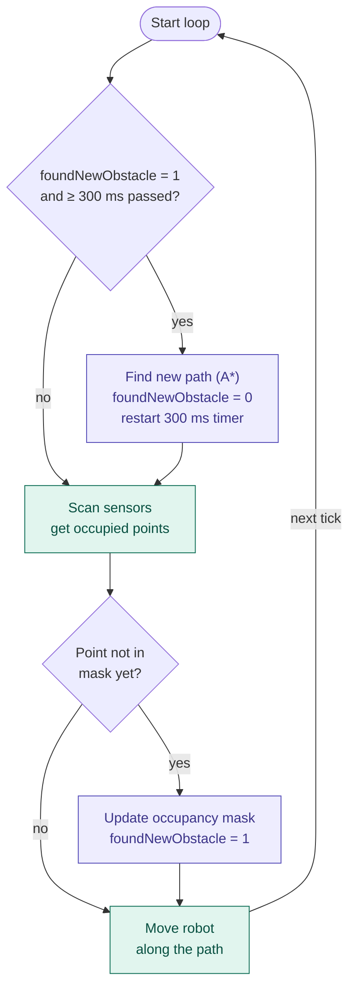

# RobotSimulator

A C++17 simulator for robot navigation in initially unknown 2D
environments. Select a target cell and watch the robot discover
obstacles, update its internal map, and adjust its planned route.

<!-- Add a screenshot or demo GIF here. -->

## Overview

RobotSimulator demonstrates grid-based mapping and path planning
in an interactive 2D environment.

The robot begins without knowledge of the surrounding obstacles.
As it moves toward a selected destination, simulated distance
measurements reveal the environment, allowing it to update its map
and replan its route.

## Technologies

- **C++17**
- **SFML 3** for graphics and window handling
- **CMake 3.22 or newer**
- **GNU gprof instrumentation** as an optional build setting

## Project Structure

```text
RobotSimulator/
├── assets/
│   └── fonts/        # Font assets
├── include/          # Header files
├── src/              # C++ implementation files
└── CMakeLists.txt    # Build configuration
```

## Main discovery loop



## Build

### Requirements

- A compiler supporting C++17
- CMake 3.22 or newer
- Git and internet access for the initial SFML download
- Platform-specific dependencies required to build SFML

SFML is fetched from its upstream repository during CMake
configuration.

### Configure and compile

```sh
cmake -S . -B build -DCMAKE_BUILD_TYPE=Release
cmake --build build --config Release --parallel
```

The executable is named `robot_simulator`. Its location depends
on the selected CMake generator and platform.

### Optional profiling build

GNU gprof instrumentation can be enabled when building with GCC:

```sh
cmake -S . -B build-profile \
  -DCMAKE_BUILD_TYPE=RelWithDebInfo \
  -DROBOT_SIMULATOR_ENABLE_PROFILING=ON

cmake --build build-profile --parallel
```

Collecting and inspecting profiling results also requires a
compatible platform and the `gprof` tool.
